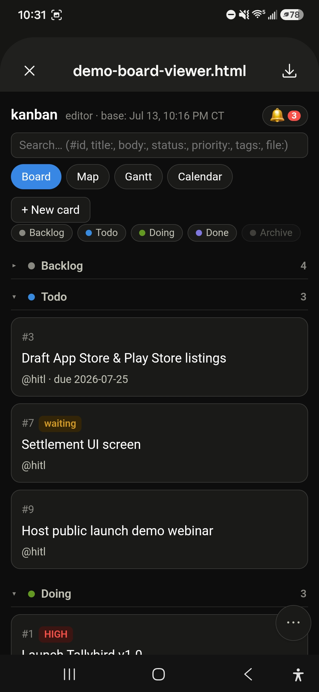
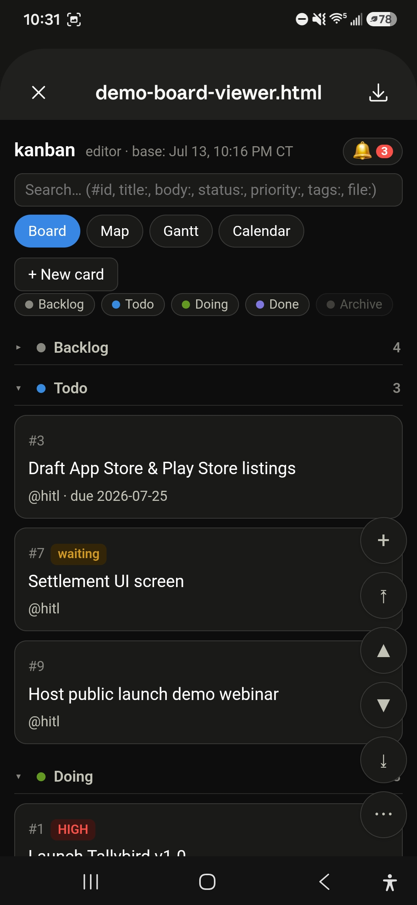
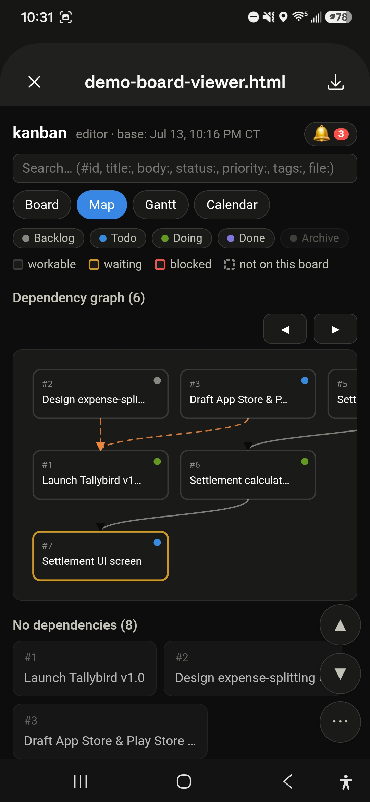
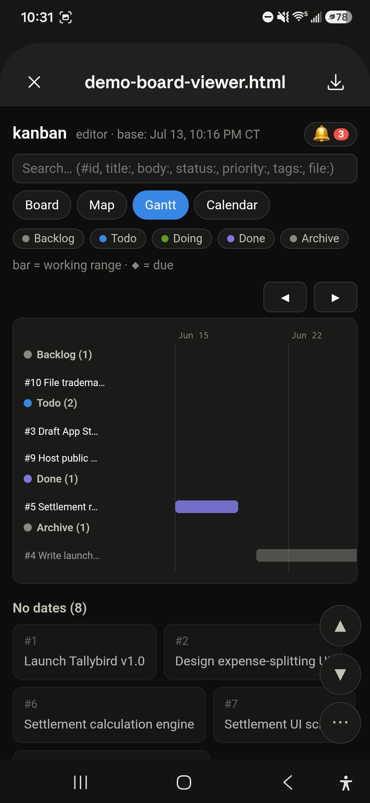
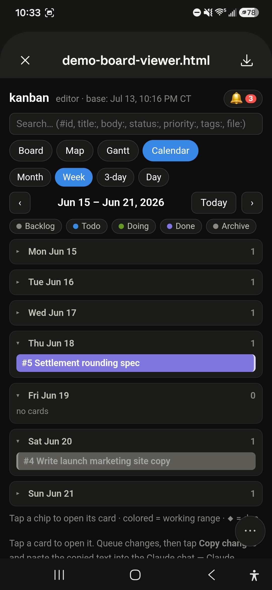
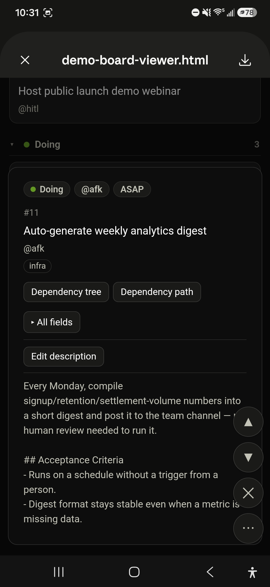
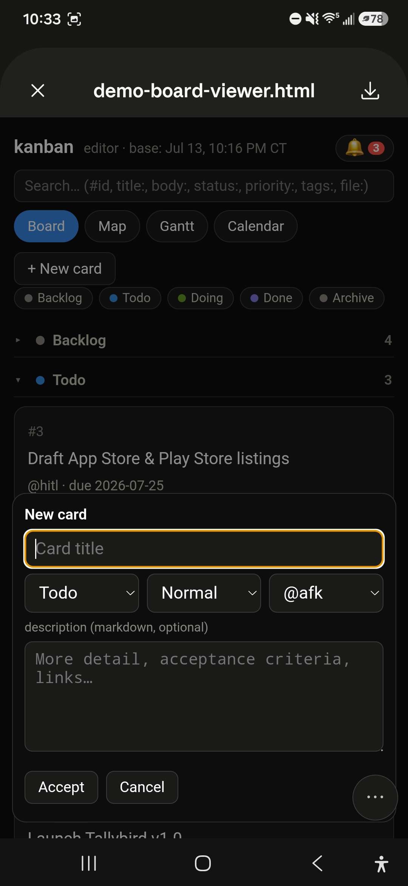
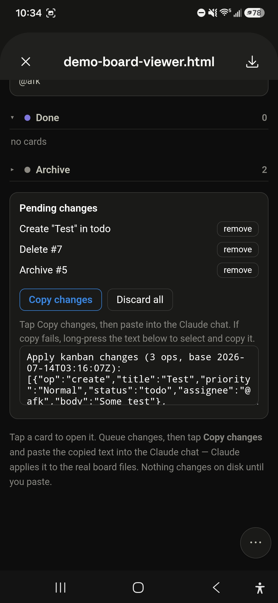

# The mobile snapshot

`kanban-snapshot` is the surface for editing the board where `kanban-web` can't
reach — a phone, a tablet, or a remote Claude session. It generates a **single,
self-contained HTML file** (no server, everything inlined) that you open and
tap through. It's read-write but **indirect**: nothing touches disk until you
paste a change payload back to Claude, who applies it under the board's write
contracts. That keeps the write path — and the `doing` gate, id allocation, and
archive rules — in one place.

## Generate it

From the repo root:

```bash
python skills/snapshot/scripts/build_editor.py examples/demo-board --out editor.html
```

(`python3` on macOS/Linux if that is the only interpreter name; on Windows `python3`
is typically the Store's install redirector, not an interpreter.)

Then open `editor.html` on the device you want to edit from (or send it to your
phone). The screenshots below are the bundled `examples/demo-board` on a phone.

Under Claude Code, this file is delivered as the board's **Board artifact** —
one hosted page per board, refreshed in place — per
`skills/snapshot/references/board-artifact.md`.

## Board



Status sections start **collapsed** — name and count only — so the board opens
as a compact overview; tap a section to expand it. A status-pill row filters
what's shown (Archive is off by default), the tabs switch between Board / Map /
Gantt / Calendar, and the header carries search and a notifications bell. Cards
show the same cues as the desktop board — here `#7` wears the amber **waiting**
tag.

## Search

The search box under the header filters every view, in the same query grammar as kanban-web, because
the page runs kanban-web's own search module: a query finds on the phone what it finds at the desk,
and edits still queued in the tray count. Terms separated by spaces AND together
(`tags:ui status:doing`), and five forms go further. `|` is or and a space binds tighter, so
`tags:ui status:doing | #12` is ui and doing, or card 12; round brackets group
(`tags:ui (status:doing | status:todo)`); a quoted value matches whole, ignoring case, or any one
element of a list (`tags:"grill"` finds a card tagged grill and not one tagged grilling), and quoted
text with no field is a phrase (`"two words"`); a bare `waiting:` finds the cards waiting for a card
that is not done, as `blocked:` and `review:` find their stickers; and `slice:` cuts every view to a
run of slices, the board's tiers (the `hierarchy:` types, top first) and then the depths of the cards
with no tier, counted from the nearest tier card above (a card right under an epic is depth 0):
`slice:objective..2`, `slice:goal`, `slice:goal..`. A board with no hierarchy cuts by depth.
After `slice:` and after `..` the box suggests the board's slices, the tiers in hierarchy
order and then the depth numbers, and a tap writes the whole term. A `|` and a bracket count
only at a token's edge, so `a|b` and `fix(auth)` stay literal text while `a |b` means `a | b`.

## Search panel

The search box has a panel of slices and pills under it, the web board's panel without its Isolate
switch. Focusing the box opens it, and the arrow at the end of the box switches that off and on (so
does the `p` key). The pill section lists blocked, review and waiting, then the board's own pills
from `config.yaml`, a `field:*` entry giving one pill per value, eight shown and the rest behind
**+N more**. Pills filter: a click turns one on, its query joining the box as one more alternative,
a right-click keeps only that pill, and each shows how many cards it leaves. The slice section,
folded to start, lists the tiers the board uses with their icons, then the depths, each with a count;
a click grows or shrinks the run, a right-click keeps only that slice, and `[` `]` `{` `}` move the
run's ends. The right-clicks need a mouse, a fine pointer that hovers: on a phone a long-press shows
the browser's own menu, and a tap turns a pill on or off or grows, narrows or clears the run of
slices. The context-menu key and Shift+F10 on a focused slice entry keep only that slice with any
pointer. Counts are taken over the cards the status pills and Archive leave, before the box and
the cut, so turning a pill on never changes the others. With the panel closed, a chip in the box
counts what is on. There is no Isolate switch here, since the page has no selection to isolate.

## Nested cards

A card with a `type` wears a chip in the color `config.yaml` gives that type.
A type with an `icon:` there starts its chip with that glyph, in the chip's color.
On a board where cards have a `rank` or a `parent`, each section lists its cards
in outline order — parents before their children, siblings by rank — and a parent
card shows how many layers sit below it (`▲2`) with a thin bar of how far along
the leaves under it are. The page carries kanban-web's own nesting rules, so both
surfaces agree on what sits under what and how it is counted; the drawing and the
type color match are the snapshot's own. It leaves the done-with-open-leaves warning,
the bar mode and rank editing to kanban-web.

## Getting around



Phones swipe-dismiss an HTML preview, so the snapshot ships a fixed
**scroll-button stack** in the corner (it doubles as the context menu): jump to
top/bottom, page up/down, add a card, and a `⋯` that cycles how much of the
stack is shown. It's how you move around without the page scrolling out from
under you.

## The other views

The same three extra views as the desktop app, rendered read-only here and
laid out for a narrow screen:


*Map — the `waiting_for` graph with a workable / waiting / blocked / not-on-board legend.*

The Map draws kanban-web's defaults: dashed lines from a parent to its children, only
to the children where their dependency chain ends, with the parent below; one graph per
tree under a heading of its root titles, biggest first; a **No relations** row for the
cards nothing links; rows that read doing, todo, backlog, done from the left and sit
centered; and cards that carry their type chip, `▲` badge and roll-up bar. The Map
options row is kanban-web's: the snapshot always draws these defaults.

The snapshot has no Graph view; that one is kanban-web only. It has no logbook, no group badges, Group tab or iteration dropdown, and no scratchpad either: all three are web-only in this release. It has no todo lists either: no `todos:` folder is read. Its Calendar and Gantt filter by the
search box as kanban-web's do, but do not jump to the nearest match when the box leaves none on
screen: page to it yourself.


*Gantt — working-range bars and due diamonds, grouped by status, with an undated-cards row below.*


*Calendar — Month / Week / 3-day / Day sub-views; the sub-month views are tap-friendly day rows with counts.*

## A card up close



Tapping a card opens its sheet in place: a status / assignee / priority / type
pill row (tap a pill to edit that field), the thread of parents above it and the
roll-up of a parent's leaves, the description, the card's children, an **All
fields** grid for everything else (type, parent, dates, tags, `waiting_for`, and
any custom frontmatter — never `rank`, which you change by dragging in the
[web editor](web.md)), and
**Hierarchy path / tree** and **Dependency path / tree** buttons that narrow every view down to
that card's set (no view switch — whatever view you're on just filters to it): the hierarchy ones
follow the parent links, the dependency ones `waiting_for`, as Explore does in the
[web editor](web.md).

## Creating a card



**+ New card** opens the same sheet in create mode — title, status, priority,
assignee, and an optional description — and nothing joins the board until you
tap **Accept**.

## The change loop



Every move, edit, create, archive, or delete you make **queues** into a
*Pending changes* tray instead of writing to disk. When you're done, tap **Copy
changes** and paste the result into the Claude chat — it looks like:

```
Apply kanban changes (3 ops, base 2026-07-14T03:16:07Z):
[{"op":"create","title":"Test","priority":"Normal","status":"todo", … }, … ]
```

Claude applies each op to the real `*.card.md` files, enforces the board
contracts, reports what it did, and can hand you a fresh editor to keep going.
The `base` timestamp is a conflict guard: if the board moved on since the editor
was generated, Claude reconciles rather than clobbering. Nothing changes on disk
until you paste.

---

For editing at a desktop, see the **[web editor](web.md)**.
